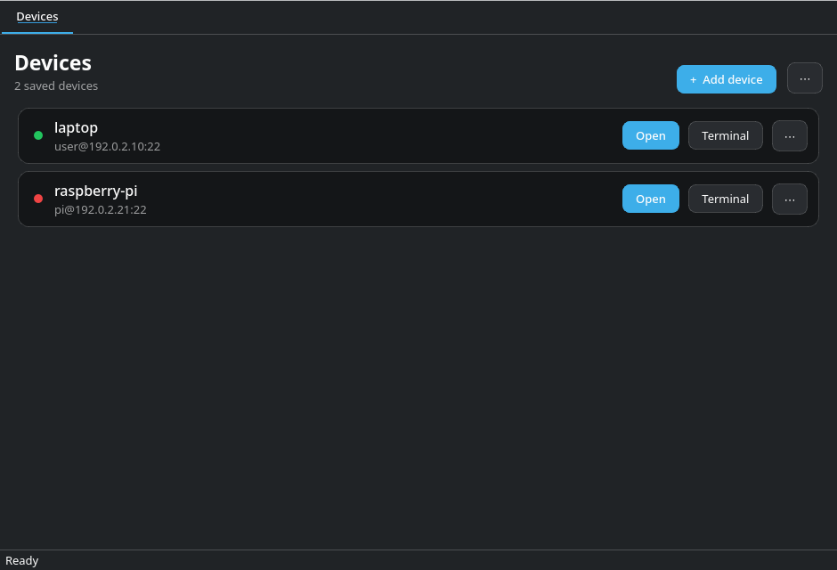
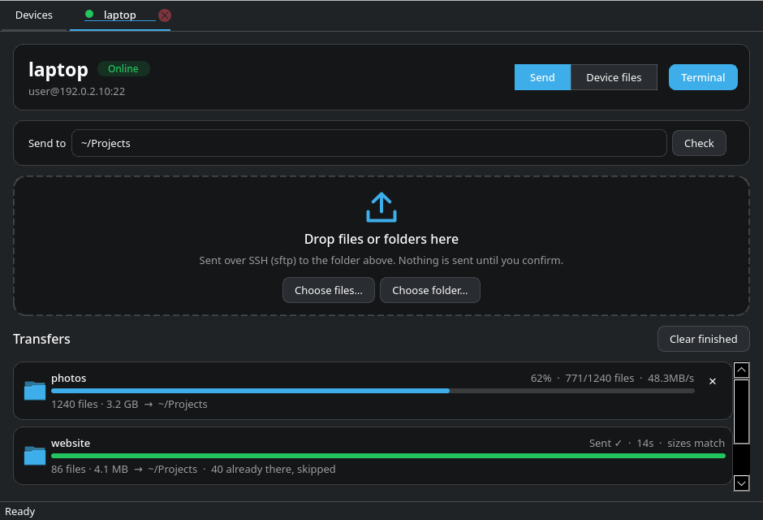
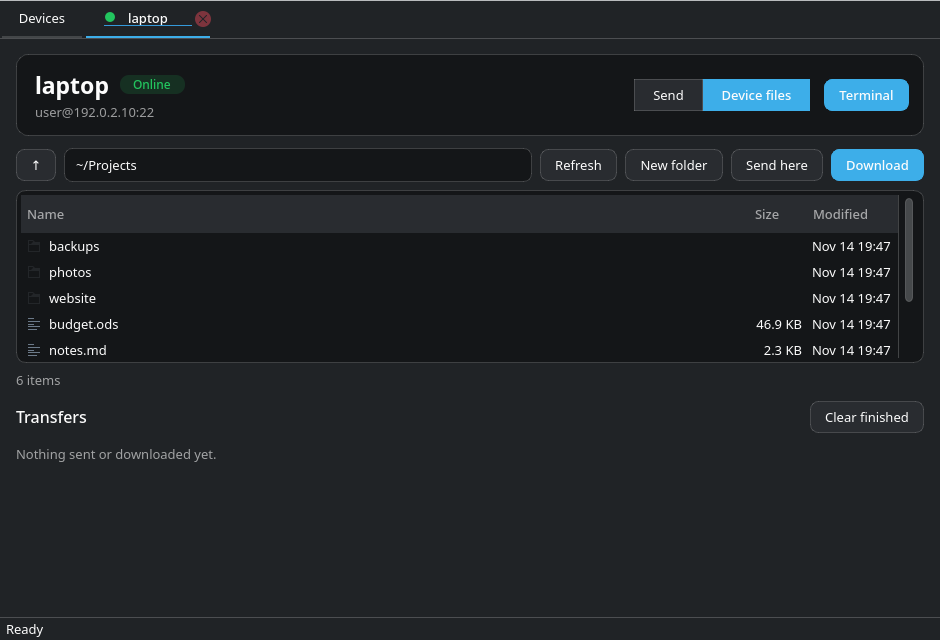
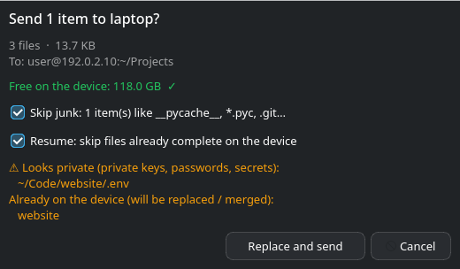
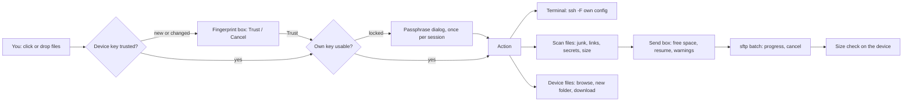

# SSH Deck

**Save your devices once, then connect, send and download files over SSH with one click. Keys, host checks and safe transfers are handled for you.**


<p>
  
  
</p>
<p>
  
  
</p>

## What is SSH Deck?

Using SSH by hand means typing `user@ip`, copying keys, fixing "REMOTE HOST IDENTIFICATION HAS CHANGED" errors and remembering `scp` options. SSH Deck is a small desktop app that keeps a list of your devices and does those steps safely in the background.

| | SSH by hand | SSH Deck |
|---|---|---|
| Connect | Type `ssh user@ip` every time | Click **Terminal** |
| Login | Password every time, or set up keys yourself | Password once; a limited key is installed for you |
| Device got a new IP or was reinstalled | Scary warning, edit `known_hosts` by hand | Box shows old and new fingerprint, you decide |
| Send a folder | `scp -r`, no overview | Drag and drop, progress, skip junk, resume |
| Get files back | `scp` with remote paths | Browse the device, select, **Download** |
| Your other SSH settings | Shared with everything | Untouched: SSH Deck uses its own config |

## Features

- **Device list**: name, IP, user, port; online dot; the IP field starts with your network's first part (e.g. `192.168.1.`).
- **One-time key setup**: type the password once; SSH Deck installs its own key, limited to terminal and file transfer (`restrict,pty`). The password is never saved or put on the command line.
- **Host key check**: fingerprint box on first connect and when a key changes; one known_hosts file per device, so an old device on the same IP never clashes.
- **Tabs per device**: Send page (drop zone) and Device files page (browse, new folder, download, "send here").
- **Safe transfers over sftp only**: no remote shell, so names with spaces, quotes, `$()` or `*` arrive exactly as they are.
- **Send box before every send**: file count, size, free space on the device, skip junk (`__pycache__`, `.git`, `node_modules`…), links skipped unless you choose, warnings for private keys and secrets.
- **Resume**: skips files that are already complete on the device; half-sent or changed files are sent again in full.
- **Checks**: free space before sending and downloading, file sizes after sending, cancel at any time.
- **Remove key from device**: takes only SSH Deck's line out of `authorized_keys`.
- **Optional passphrase**: asked once per session, kept only while SSH Deck runs.
- **Desktop friendly**: app menu entry and icon, light and dark themes, notifications, shortcuts (Ctrl+N, Ctrl+W, Ctrl+O, Ctrl+T, F5).

## How it works



## Quick start

**Requirements**
- Linux desktop (tested on KDE Plasma, Wayland)
- Python 3.9 or newer
- PySide6 (Qt 6 for Python)
- OpenSSH client tools: `ssh`, `sftp`, `ssh-keygen`, `ssh-keyscan`, `ssh-copy-id`, `ssh-agent`, `ssh-add`
- `setsid` from util-linux
- Optional: `notify-send` (notifications), `kdialog` or `zenity` (passphrase dialog), Konsole and Dolphin (default terminal and file manager, changeable)

**1. System packages**

| Distro | Command |
|---|---|
| Arch / CachyOS / Manjaro | `sudo pacman -S --needed pyside6 openssh util-linux` |
| Debian / Ubuntu | `sudo apt install python3 python3-venv openssh-client util-linux libxcb-cursor0` |
| Fedora | `sudo dnf install python3 openssh-clients util-linux` |

**2. Get the code**
```bash
git clone https://github.com/Muzasio/sshdeck.git
cd sshdeck
```

**3. Python dependency**
- Arch-based: already installed with `pyside6` above.
- Other distros (virtual environment):
  ```bash
  python3 -m venv .venv
  .venv/bin/pip install PySide6
  ```

**4. Run**
```bash
python3 sshdeck.py          # Arch-based
.venv/bin/python sshdeck.py # with the virtual environment
```
The first start adds **SSH Deck** to your app menu (with its icon). After that, start it from the menu.

**5. On each device you want to reach**: an SSH server must run.
```bash
sudo systemctl enable --now sshd   # Arch, Fedora
sudo systemctl enable --now ssh    # Debian, Ubuntu
```
Then in SSH Deck: **+ Add device**, fill in name, IP, user and the password once, and check the fingerprint when asked.

**Remove**
1. Optional: on each device card, **⋯ → Remove key from device…**
2. Delete the app, its menu entry and its data:
   ```bash
   rm ~/.local/share/applications/sshdeck.desktop
   rm -r ~/.config/sshdeck
   rm -r sshdeck          # the cloned folder
   ```
3. Only if you used "Browse in file manager": remove the two `SSH Deck` lines at the top of `~/.ssh/config` (a backup `config.bak-sshdeck-<date>` sits next to it).

## Settings

`~/.config/sshdeck/settings.json` (open it from **⋯ → Open settings file**). Wrong values fall back to the defaults.

| Key | Default | Meaning |
|---|---|---|
| `terminal` | `["konsole", "-e"]` | Terminal for the Terminal button, e.g. `["kitty", "-e"]` |
| `file_manager` | `["dolphin"]` | For "Browse in file manager" (opens `sftp://`) |
| `check_every_seconds` | `30` | Online dot check, only while the window is visible |
| `timeout_seconds` | `5` | Connect timeout |
| `trust_cache_seconds` | `120` | Time before the device key is checked again |
| `unlock_minutes` | `60` | How long a passphrase-protected key stays unlocked |
| `download_dir` | `~/Downloads` | First folder shown when downloading |
| `junk` | `__pycache__`, `*.pyc`, `.git`, `node_modules`, `.venv`, … | Names skipped when "Skip junk" is on |

Data lives in `~/.config/sshdeck/` (folder `700`, files `600`): device list, settings, generated `ssh_config`, one `known_hosts` file per device and SSH Deck's own key.

## Known limits

- **Resume** compares size and modified time **to the minute** (sftp shows no seconds). A file changed within the same minute with the same size counts as complete.
- Half-sent files are sent again from the start (never appended, so a different file can't be corrupted).
- Size check after sending runs for up to 5,000 files; bigger sends are not checked file by file.
- Download progress for folders shows files and speed, not a percentage (sizes are not known in advance).
- Free space shows "unknown" on servers without the sftp `statvfs` extension (some Windows servers).
- Links to folders are never sent; links to files only when you tick the box.
- Windows devices: key setup for administrator accounts needs `administrators_authorized_keys` (not handled).
- Many thousands of tiny files are slow over any SSH tool; pack them first (`tar -czf files.tar.gz folder`) and send one file.

## Troubleshooting

| Message | Fix |
|---|---|
| Can't reach the device | Is it on? Is the SSH server running (`sudo systemctl status sshd`)? Does `nc -zv <ip> 22` say *succeeded*? |
| The key is not set up | Device card **⋯ → Set up key…**, type the password once |
| Key changed | Compare the fingerprint with `ssh-keygen -lf /etc/ssh/ssh_host_ed25519_key.pub` on the device; trust only if it matches |
| Wrong password (or password login is turned off) | Check the user name and password; the device may only allow keys (`PasswordAuthentication no`) |
| No permission there | Send to a folder the device user can write to, e.g. `~/Downloads` |
| Not enough space on the device | Free space on the device, or send fewer files |
| The SSH Deck key is locked | Enter the passphrase in the dialog, or **⋯ → Unlock key now** |
| Terminal button does nothing | Set `terminal` in settings to a terminal you have |
| Missing program: setsid / sftp / … | Install `util-linux` / the OpenSSH client package |

## Status

**Tested**
- CachyOS (Arch), KDE Plasma 6 on Wayland, Python 3.14, PySide6 6.12, OpenSSH 10.6: app start, menu entry, device tab, sending a folder to a second CachyOS laptop (earlier version of the transfer code).
- Test suite (`python3 -I tests/test_security.py`): 63 tests against a local test SSH server in a sandbox home (input checks, config injection, file permissions, host keys, password handling, key limits, key removal, passphrase agent, scan rules, uploads, downloads, resume, free space, cancel, GUI flow). Also passed on the laptop (earlier 59-test version).
- Quick start on a fresh clone with a sandbox home (Arch path): clone, run, menu entry created, tests, remove.
- Code parses with the Python 3.9 grammar (runtime tested on 3.14 only).

**Not tested yet**
- Key setup with a password on a real device (the test server cannot check passwords)
- "Browse in file manager" (Dolphin `sftp://`)
- Debian, Ubuntu and Fedora install steps, and the virtual environment path
- Windows and macOS devices
- GNOME and other desktops

## License

MIT, see [LICENSE](LICENSE).
